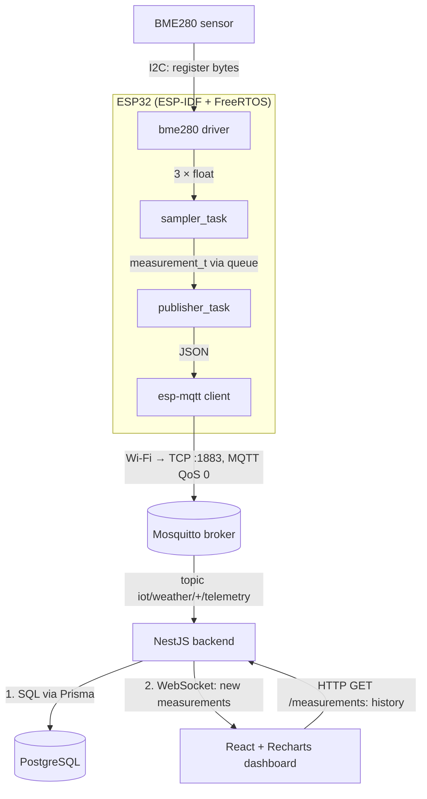

# Метеостанция на ESP32

 Метеостанция на ESP32 с датчиком BME280, который измеряет температуру, давление и влажность окружающей среды. 
Данные передаются по mqtt брокеру на Nest сервер, где они валидируются и отображаются на React dashboard.

## Что сделано руками

- Архитектура FreeRTOS(задачи:снять замер, отправить по mqtt)
- Драйвер управления bme280 по datasheet с oversampling x1 и чтением калибровочных коэффициентов и компенсацией
- Nest(Выступает в роли MQTT-клиента и REST API. Принимает, валидирует сырые данные и сохраняет их в БД) и React(Строит на основе этих данных непрерывные графики)

## Архитектура

## Структура репозитория

| Папка | Что внутри |
|---|---|
| `firmware/` | |
| `backend/` | |
| `frontend/` | |
| `docs/` | |

## Быстрый старт

### Прошивка

<!-- Шаги от клона до `idf.py flash monitor`. Не забудь про secret.h.example. -->

### Бэкенд

<!-- Клон, npm install, .env из .env.example, prisma generate, миграции, запуск. -->

### Фронтенд

<!-- npm install, .env, npm run dev. -->

### Брокер MQTT

<!-- Mosquitto и две строки конфига, без которых он слушает только localhost. -->

## Инженерные заметки

<!-- 3-5 пунктов: решение или найденная ошибка и чему она научила. Это самый ценный раздел. -->

## Ограничения

<!-- Честно: брокер без авторизации, IP брокера зашит в прошивке, QoS 0 теряет данные при обрывах и так далее. -->

## Планы

<!-- Deep sleep, OTA, корпус под 3D-печать. -->
