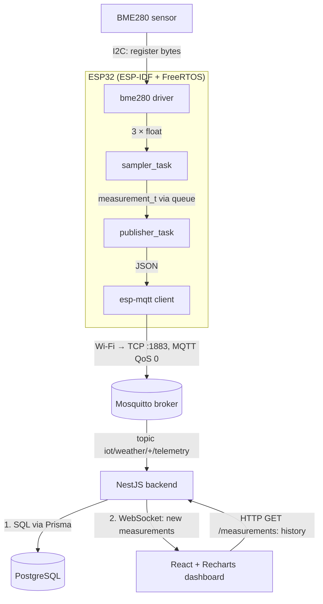

# Архитектура

Путь одного измерения от датчика до графика в браузере.

### Зачем два канала в браузер

Браузер получает данные двумя каналами: HTTP и WebSocket
WebSocket для непрерывного обновления графиков
HTTP для истории замеров.
Без WebSоcket график обновляется только принудительно
БеЗ HTTP график пуст, истории замеров нет